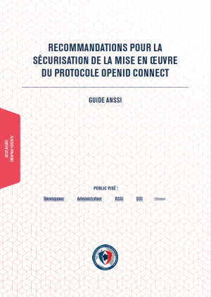

ANSSI security guidelines
=========================

|anssi-logo|

.. |anssi-logo| image:: logos/240px-ANSSI_Logo.svg.png
   :class: align-center

Presentation
------------

The `Agence Nationale de la Sécurité des Systèmes d'Information`_ *(ANSSI)*
is a French Agency for the Security of Information Systems.

They published a `document to securize OpenID Connect`_.
It contains around fifty recommandations to strengthen your OIDC service, as OpenID provider or relying party.

We describe here how to configure LemonLDAP::NG to match the majority of these recommandations.
You can find the list at the end of the page (in French language, as the original document).

.. _Agence Nationale de la Sécurité des Systèmes d'Information: https://ssi.gouv.fr

.. _document to securize OpenID Connect: https://cyber.gouv.fr/publications/recommandations-pour-la-securisation-de-la-mise-en-oeuvre-du-protocole-openid-connect

|clear|

.. |clear| raw:: html

 

Directly implemented in LL::NG
------------------------------

A lot of recommandations are built-in features of LemonLDAP::NG, so there is nothing to configure to respect them:

* **R6** Vérifier le nom de domaine
* **R10** Systématiser l’envoi du paramètre state
* **R11** Générer aléatoirement le paramètre state
* **R13** Utiliser les cookies de session
* **R15** Générer aléatoirement le paramètre nonce
* **R17** Se protéger contre les redirections ouvertes
* **R18** Générer aléatoirement les authorization code
* **R20** Associer le code authorization code au client OIDC
* **R24** Générer aléatoirement les access token
* **R26** Vérifier l’intégrité de l’ID Token
* **R28** Vérifier les informations d’un ID Token
* **R29** Vérifier le niveau d’authentification de l’utilisateur
* **R30** Rendre inutilisables les authorization code
* **R31** Transmettre les access token par l’entête Authorization
* **R33** Restreindre la durée de validité d’un access token
* **R34** Croiser les informations du UserInfo et de l’ID Token
* **R47** Journaliser les évènements importants

Some other are not directly related to LemonLDAP::NG, but come with a correct configuration of the web server or the global infrastructure:

* **R3** Mettre en œuvre HTTPS : lié au serveur Web
* **R4** Appliquer les recommandations de sécurité relatives à TLS
* **R5** Imposer aux clients OIDC des suites cryptographiques recommandées pour les communications serveur à serveur
* **R46** Mettre en oeuvre un système de journalisation

LL::NG as OpenID Connect Provider
---------------------------------

* **R1** Utiliser en priorité la cinématique authorization code pour les applications Web

This is the default configuration, be sure to not enable Implicit or Hybrid flows in ``OpenID Connect Service`` > ``Security``.

* **R9** Imposer un mode de transmission des paramètres dans une demande d’authentification

You need to fix the access mode for each relying party in ``Options`` > ``Security`` > ``Require JWS for authorization requests``

* **R12** Détecter les demandes d’authentification sans le paramètre state

Require the state parameter in ``Options`` > ``Security`` > ``Require "state" in authorization request``

* **R16** Détecter les demandes d’authentification sans le paramètre nonce

Require the nonce parameter in ``Options`` > ``Security`` > ``Require "nonce" in authorization request``

* **R19** Limiter la durée de vie d’un authorization code

The default value is already quite low (1 minute) but you can still change it in ``OpenID Connect Service`` > ``Timeouts`` > ``Authorization Codes``.
You can configure timeouts for other tokens too.

* **R21** Stocker les authorization code sous forme d’empreinte
* **R25** Stocker les access token sous formes d’empreintes

Enable hashed session in ``General Parameters`` > ``Advanced parameters`` > ``Security`` > ``Hashed session storage``

* **R23** Utiliser une authentification du client OIDC adaptée

Require JWS authentication on token endpoint in  ``Options`` > ``Security`` > ``Token endpoint authentication method``
You can also enforce this for userinfo endpoint.

* **R32** Ne pas écrire dans les journaux les access token

Configure the log level to info or notice (access tokens can be seen in debug level).

* **R35** Générer aléatoirement les secrets d’authentification partagés

Use a random value for client_secret (for example with command ``pwgen``)

* **R36** Renouveler les secrets d’authentification partagés

There is no automatic renewal of client_secret, you need to plan it on your side.

* **R37** Utiliser un secret différent par client OIDC

Simple. Just be sure to have different client_secret values for each configured relying party.

* **R38** Restreindre l’accès au secret d’authentification
* **R40** Restreindre l’accès à la clé privée de signature

Quite simple. Be sure your manager is well protected, and your configuration backend too.

* **R42** Utiliser des fonctions de hachage recommandées
* **R43** Utiliser des mécanismes de signature recommandés
* **R44** Fixer l’algorithme utilisé pour le JWS

Forbid the use of **HS** algorithms, prefer those with public/private keys. You can configure the algorithm of JWS (ID Token, and if configured as JWT, access token and userinfo) in ``Options`` > ``Algorithms``.

* **R48** Désactiver la découverte automatisée

Configuration metadata are available anonymously, you can disable access in  ``OpenID Connect Service`` > ``Security`` >  ``Don't display metadata``

* **R49** Ne pas utiliser l’enrôlement automatisé

This is the defaut configuration, be sure to keep this disabled in ``OpenID Connect Service`` > ``Dynamic registration`` > ``Activation``

LL::NG as OpenID Connect Relying Party
--------------------------------------

* **R8** Utiliser un JWS protégé par un HMAC
* **R8+** Utiliser un JWS protégé par une signature
* **R42** Utiliser des fonctions de hachage recommandées
* **R43** Utiliser des mécanismes de signature recommandés
* **R44** Fixer l’algorithme utilisé pour le JWS

Set method and algoroithm in ``Options`` > ``Protocol`` > ``Authentication method for authorization code request`` and ``Signature algorithm for authorization code authentication``. Forbid the use of **HS** algorithms, prefer those with public/private keys.

* **R14** Systématiser l’envoi du paramètre nonce

This is the default configuration, check it in ``Options`` > ``Protocol`` > ``Use nonce``

* **R23** Utiliser une authentification du client OIDC adaptée

Set authentication on token endpoint in ``Options`` > ``Protocol`` > ``Token endpoint authentication method``, prefer JWS authentication method.

* **R32** Ne pas écrire dans les journaux les access token

Configure the log level to info or notice (access tokens can be seen in debug level).

* **R38** Restreindre l’accès au secret d’authentification
* **R40** Restreindre l’accès à la clé privée de signature

Quite simple. Be sure your manager is well protected, and your configuration backend too.

List of recommandations
-----------------------

* **R1** Utiliser en priorité la cinématique authorization code pour les applications Web
* **R2** Mettre en place une politique de sécurité
* **R3** Mettre en œuvre HTTPS
* **R4** Appliquer les recommandations de sécurité relatives à TLS
* **R5** Imposer aux clients OIDC des suites cryptographiques recommandées pour les communications serveur à serveur
* **R6** Vérifier le nom de domaine
* **R7** Utiliser le certificate pinning
* **R8** Utiliser un JWS protégé par un HMAC
* **R8+** Utiliser un JWS protégé par une signature
* **R9** Imposer un mode de transmission des paramètres dans une demande d’authentification
* **R10**  Systématiser l’envoi du paramètre state
* **R11** Générer aléatoirement le paramètre state
* **R12** Détecter les demandes d’authentification sans le paramètre state
* **R13** Utiliser les cookies de session
* **R14** Systématiser l’envoi du paramètre nonce
* **R15** Générer aléatoirement le paramètre nonce
* **R16** Détecter les demandes d’authentification sans le paramètre nonce
* **R17** Se protéger contre les redirections ouvertes
* **R18** Générer aléatoirement les authorization code
* **R19** Limiter la durée de vie d’un authorization code
* **R20** Associer le code authorization code au client OIDC
* **R21** Stocker les authorization code sous forme d’empreinte
* **R22** Vérifier le paramètre state associé à la session de l’utilisateur
* **R23** Utiliser une authentification du client OIDC adaptée
* **R24** Générer aléatoirement les access token
* **R25** Stocker les access token sous formes d’empreintes
* **R26** Vérifier l’intégrité de l’ID Token
* **R27** Utiliser un secret partagé différent du client_secret pour générer le HMAC de l’ID Token
* **R28** Vérifier les informations d’un ID Token
* **R29** Vérifier le niveau d’authentification de l’utilisateur
* **R30** Rendre inutilisables les authorization code
* **R31** Transmettre les access token par l’entête Authorization
* **R32** Ne pas écrire dans les journaux les access token
* **R33** Restreindre la durée de validité d’un access token
* **R34** Croiser les informations du UserInfo et de l’ID Token
* **R35** Générer aléatoirement les secrets d’authentification partagés
* **R36** Renouveler les secrets d’authentification partagés
* **R37** Utiliser un secret différent par client OIDC
* **R38** Restreindre l’accès au secret d’authentification
* **R39** Utiliser des certificats pour authentifier les JWS
* **R40** Restreindre l’accès à la clé privée de signature
* **R41** Vérifier la révocation des certificats
* **R42** Utiliser des fonctions de hachage recommandées
* **R43** Utiliser des mécanismes de signature recommandés
* **R44** Fixer l’algorithme utilisé pour le JWS
* **R45** Sécuriser l’application Web OIDC
* **R46** Mettre en oeuvre un système de journalisation
* **R47** Journaliser les évènements importants
* **R48** Désactiver la découverte automatisée
* **R49** Ne pas utiliser l’enrôlement automatisé
* **R50** Sécuriser l’interface Web de configuration d’un client OIDC
* **R51** Vérifier l’identité des fournisseurs de service
