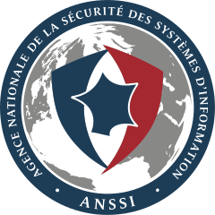

ANSSI security guidelines
=========================

|anssi-logo|

Presentation
------------

The `Agence Nationale de la Sécurité des Systèmes d'Information`_ *(ANSSI)*
is a French Agency for the Security of Information Systems. They published a
`document to securize OpenID-Connect`_.
This document explain what to do to follow it.

.. _Agence Nationale de la Sécurité des Systèmes d'Information: https://ssi.gouv.fr

.. _document to securize OpenID-Connect: https://cyber.gouv.fr/publications/recommandations-pour-la-securisation-de-la-mise-en-oeuvre-du-protocole-openid-connect

LLNG as OpenID-Connect Provider
-------------------------------

List of points to enable if possible:

* Enable **Hashed session storage** in security parameters
* Allow only "authorization code" flow
* Forbid the use of **HS** algorithms, prefer those with public/private keys
* Disable automatic enrollment
* Limit the TTL of ``access_token`` to the strict needed delay
* Don't allow "open redirections"
* Configure webserver to disallow access to ``/.well-known/openid-configuration``
* Code requests
    * Fix the access mode for each relying party *(prefer JWS)*
    * Require state and nonce
* Token endpoint
    * Require JWS authentication
* UserInfo endpoint
    * Accept only authentication using ``Authorization: Bearer ...``
* Use hashed storage for sessions *(this includes OIDC tokens)*

LLNG as OpenID-Connect Relying-Party
------------------------------------

List of points to enable if possible:

* Enable **Hashed session storage** in security parameters
* always use ``nonce``
* Forbid the use of **HS** algorithms, prefer those with public/private keys
* Code requests
    * Use JWS to pass request parameters
* Token endpoint
    * Use JWS authentication
* Use hashed storage for sessions
