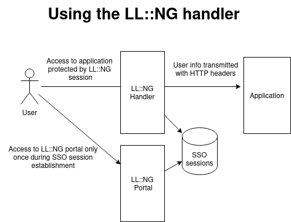

Before you begin
================

Before you install LemonLDAP::NG on a production environment, you need to make
several choices regarding architecture.

Application protection
----------------------

Protecting applications is the reason why you are installing LemonLDAP::NG.
Before starting with the installation, you need to inventory all the
applications you want to protect and how you can protect them.

SSO protocols
~~~~~~~~~~~~~

This is the simplest option: your application is natively compatible with an SSO protocol such as CAS, SAML or OpenID Connect:

LemonLDAP::NG Handler
~~~~~~~~~~~~~~~~~~~~~

Some older applications can only be protected by placing a reverse proxy in
front of them.  In this case, applications will receive user information
through HTTP headers.  LemonLDAP::NG provides a *Handler* component to perform
this function.

The handler has always been the central feature of LemonLDAP::NG, however it
comes at a cost:

* You applications must share the SSO server's DNS suffix so that cookies can
  be transmitted in between the portal and handler (:doc:`CDA <cda>` lets you
  use different domains, but it also comes at a cost)
* All your HTTP trafic will be centralized through the handler, therefore you
  must carefully size and configure your handler server if you don't want it to
  be a bottleneck

.. note::

    You can use both protection modes at the same time on a single
    LemonLDAP::NG instance. On small deployments (hundreds of users) you can
    also probably run the handler and portal on the same server. On large
    deployments you can run as many handlers as you like.

Web Server
----------

LemonLDAP::NG is compatible with two common web servers

-  Nginx
-  Apache HTTPd

If you choose Apache, and intent to use the LemonLDAP::NG Handler, you must use
the *Prefork MPM*, since *mod_perl* is not compatible with other MPMs.

If you are an advanced user, and you only want to run the Portal and/or Manager
components, you can use any PSGI compatible web server instead.

Nginx is the recommended choice for running a *Handler*. If you are not running
a *Handler*, you can freely choose your favorite between *Apache* and *Nginx*.

DNS configuration
-----------------

If you are running a *Handler*, it is highly recommended to dedicate a DNS
subdomain to SSO-protected apps, such as ``*.example.com``.

In every case, you will need at least:

* One DNS record for the portal (``auth.example.com``)
* One DNS record for the manager (``manager.example.com``)

TLS configuration
-----------------

For production use, TLS is extremely recommended. You will need X.509
certificates for at least ``auth.example.com`` and ``manager.example.com``.

