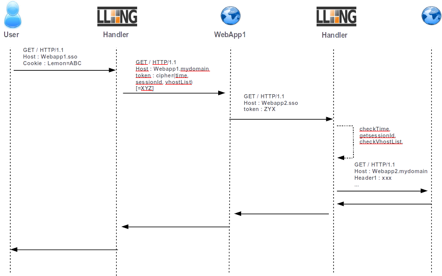

Handling server webservice calls
================================

In modern applications, web application may need to request some other
web applications on behalf of the authenticated users. There are three
ways to do this:

-  the Ugly : provide to all applications SSO cookie. Not secured
   because SSO cookie can be caught and used everywhere, every time by
   everyone!!! **NOT RECOMMENDED**.
-  the Bad (:doc:`Secure Token Handler<securetoken>`)
   : **Deprecated**. Can be used in specific cases
-  the Good (Service Token Handler): See below ! (Thanks Sergio...)

The "Bad" method consists to give the token (cookie value) to WebApp1
which uses it as cookie header in its request. Since 2.0 version, LL::NG
gives a better way (the Good !) to do this by using limited scope
tokens.

Tokens are time limited (30 seconds by default) and URL restricted.

|Kinematic|

Webapp1 handler configuration
-----------------------------

Select **Main** handler type to protect WebApp1 and insert a header
named **X-Llng-Token** filled with this value:

.. code:: perl

   token( $_session_id, 'webapp2.example.com', 'webapp3.example.com', 'serviceHeader1=webapp1.example.com', "testHeader=$uid" )

WebApp1 can read this header and use it in its requests by setting the
``X-Llng-Token`` header. The token is built by using the session ID and
authorized virtualhosts list. By default, the Service Token is only
available during 30 seconds and for specified virtualhosts. The token
can be use to send service headers to webapp2 like origin host by
example.

You can set ServiceToken TTL in the virtualHost options in Manager for
each required virtualHost.

You can also set ServiceToken default timeout (30 seconds) by editing
``lemonldap-ng.ini`` in section [handler]:

.. code:: ini

   [handler]
   handlerServiceTokenTTL = 30

.. note::

    Service token timeout can be set for each virtual hosts.

Webapp2 handler configuration
-----------------------------

Change handler type to **ServiceToken**. So it is able to manage both
user and server connections. And that's all !

